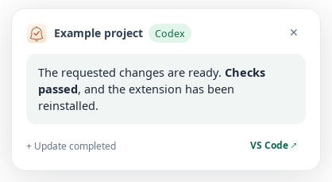
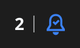

# Codex Ubuntu Notifications

The Ubuntu top bar shows how many local VS Code chats are working across workspaces. It flashes blue while work is active and turns green at zero when tracked work finishes. Multiple VS Code windows share one count. Use **Flash While Working** for a steady display or **Ubuntu Top-Bar Icon** to hide it.

The indicator requires `gjs`, `gir1.2-ayatanaappindicator3-0.1` and Ubuntu AppIndicators. Its menu uses English action labels, with working chats grouped by workspace, for example **Open workspace: my_project (1 chat working)**. Selecting a workspace opens it in VS Code. Conversation titles are neither read nor shown by the indicator. Workspace names retain their original language. The **Open VS Code** action includes the current activity summary; the menu also has a **Flash while working** checkbox. Activity updates preserve existing menu items for keyboard navigation. Counts update about every two seconds. It reads local session lifecycle events without modifying Codex databases. Previous-boot sessions, archived chats, CLI chats and subagents are excluded. An unfinished session with no log updates for 15 minutes is uncertain: the label adds `?`, and the icon is gray when no confirmed work remains. Gray also means the activity reader is unavailable. Green means idle, including cancelled or failed turns; it does not assert that every task succeeded. The extension's configured Codex home defines the scope, and the shared indicator follows the first owning window's configuration.

Independent VS Code extension for completion alerts in local Codex workspaces on Ubuntu. By default it shows a bottom-left answer preview and plays a chime. Ubuntu desktop notifications can be enabled separately. A configuration panel reports missing dependencies and monitoring failures.

This is not an official OpenAI or Microsoft extension. It relies on a specific local Codex database schema, which can change independently of this project.

## Screenshots

PDF links in an answer add an **Open PDF** button to the bottom-left preview. Local files open with the system default application; remote PDF links use the default URI handler. Multiple PDFs appear in a chooser. Relative file links resolve against the workspace.

Bottom-left answer notification, captured from the running GTK popup with sample content:



| Working: flashing blue | Finished: steady green |
| --- | --- |
|  |  |

The screenshots use sample content and activity counts.

## Compatibility and verification

Compatibility targets are Ubuntu **22.04, 24.04 and 26.04 LTS**, GNOME/KDE Plasma/Xfce, X11/Wayland and VS Code `.deb`/Snap. These are targets, **not a claim that every combination has been manually verified**. No desktop combination or ARM64 device has been certified by the automated tests. See [TESTING.md](TESTING.md) for the release checklist and verification matrix.

- Requires VS Code 1.90 or newer, a trusted local folder and initialized Codex databases.
- Local Linux desktop windows only. SSH, containers, WSL, Codespaces, browser VS Code, virtual workspaces and non-Linux platforms are not supported.
- Without a folder open, automatic monitoring is paused. The test command still works.
- Notifications require a running FreeDesktop notification service and a desktop session bus. Do Not Disturb and lock-screen behavior are controlled by the desktop.
- Native notifications work independently of the optional preview. The preview requires GTK3, GJS and a working X11 display, including XWayland on Wayland sessions. Pure Wayland sessions without XWayland use the in-editor fallback; native notifications remain optional. Positioning on arbitrary Wayland compositors is not promised.
- Audio tries PipeWire, then PulseAudio, then ALSA. ALSA is WAV-only and does not apply the configured volume. Other formats depend on the codecs supported by the installed backend. Unavailable Yaru sound presets are hidden.

## Dependencies

Python 3 with its standard `sqlite3` module is required for monitoring. Ubuntu 22.04's Python 3.10 is supported. Node.js is not required by users installing a VSIX; VS Code provides the extension runtime.

On first use in a trusted local Ubuntu folder, the extension offers **Install Missing Dependencies** when packages are missing. You can also use the **Finish Setup** sidebar card or run **Codex Ubuntu Notifications: Install Missing Dependencies** from the Command Palette. Choosing **Later** dismisses the first-use prompt for this VS Code profile; the sidebar and command remain available.

Setup checks the enabled features, detects the existing audio system when possible, and opens a visible terminal running `sudo apt-get install`. Review the package changes, enter your administrator password in that terminal if asked, and confirm installation. If audio detection is inconclusive, select your existing audio system first. Setup skips recommended packages and refuses package removals. It installs playback tools without deliberately installing or switching audio servers. Libraries that cannot be checked until GJS is installed may also appear in the command; apt leaves already installed packages in place. When the task finishes, dependencies are checked again and monitoring restarts. Failed or cancelled setup can be retried.

Installation requires network access to your configured Ubuntu package repositories and administrator privileges. AppIndicators still needs to be enabled in your desktop session, and the answer preview still requires X11/XWayland. Setup does not resolve display/session failures. Other Linux distributions require manual installation using their own package manager.

For manual setup:

Desktop notifications:

```bash
sudo apt install python3 libnotify-bin
```

Choose audio tools appropriate for the audio server already in use:

```bash
# PipeWire
sudo apt install pipewire-bin
# PulseAudio
sudo apt install pulseaudio-utils
# Optional WAV-only ALSA fallback
sudo apt install alsa-utils
```

Optional preview dependencies:

```bash
sudo apt install gjs gir1.2-gtk-3.0
```

For the optional Ubuntu top-bar indicator, also install `gir1.2-ayatanaappindicator3-0.1` and enable Ubuntu AppIndicators. The count, separator and logo are rendered together so Ubuntu preserves their order. Other tray implementations may size wide icons differently.

A working X11/XWayland session is also required for the preview. Run **Codex Ubuntu Notifications: Check Configuration** to check the current session. Finding a binary alone does not prove its service or codecs work; runtime failures are reported too.

## Configuration

Use the activity-bar panel or VS Code settings. Settings are machine-local and cannot be supplied by a repository's workspace settings.

The **Colors** section provides a color picker and editable hex field for each top-bar icon color and the notification's card, answer area, text, button, border and Codex badge. Hex fields accept values such as `#3b82f6`, `3b82f6` or `#abc`. Clear a field or use its reset button to restore the default; **Reset All Colors** clears every override. Changes save automatically and apply to subsequent notifications. The Codex label is centered beside the project name inside a rounded badge. Unset notification colors continue to follow the VS Code theme. Native Ubuntu notifications keep the desktop's colors.

| Setting under `codexNotifier` | Default | Meaning |
| --- | --- | --- |
| `enabled` | `true` | Start or stop automatic monitoring. |
| `mode` | `always` | `always` or `unfocused`. |
| `topBarIndicator` | `true` | Show one shared top-bar count, separator and bell icon. |
| `topBarFlash` | `true` | Flash blue while working; disable for static blue. |
| `colors` | `{}` | Optional hex color overrides, editable using the sidebar color pickers. |
| `desktopNotification` | `false` | Optionally show a native Ubuntu desktop notification. |
| `previewCard` | `true` | Request an optional GTK3 answer preview. |
| `previewDuration` | `7` | Preview duration, 3 to 20 seconds. |
| `sound` | `true` | Play completion audio. |
| `soundChoice` | `synth-2` | Four original startup presets (Dawn, Drift, Halo, Horizon) or `custom:<filename>`. Legacy preset IDs remain accepted. |
| `volume` | `55` | 5 to 100 percent; unavailable with ALSA fallback. |
| `vscodeToast` | `false` | Also show an in-editor message. |
| `codexHome` | empty | Absolute Codex home path. Empty uses `CODEX_HOME`, then `~/.codex`. Changing it restarts the reader. |

Commands:

- **Codex Ubuntu Notifications: Install Missing Dependencies**: install packages for the enabled features in a visible Ubuntu terminal, then recheck dependencies and restart monitoring. Passwords are entered directly in the terminal.
- **Codex Ubuntu Notifications: Check Configuration**: recheck dependencies, restart the monitor and open the diagnostic Output channel.
- **Codex Ubuntu Notifications: Send Test Notification**: test the selected channels, even when automatic monitoring is disabled or VS Code is focused.
- **Codex Ubuntu Notifications: Import Custom Sound File**: copy a regular local `.wav`, `.ogg`, `.oga`, `.mp3` or `.flac` file, up to 20 MiB. The import uses a unique filename and does not overwrite existing sounds. Symbolic links are rejected.

Existing custom sounds remain in `~/.config/codex-notifier/sounds/`. Oversized or linked files are not listed or played.

Ubuntu desktop notifications are disabled by default and can be enabled with **Ubuntu Desktop Popup** in the sidebar. If the bottom-left preview is unavailable or fails, an in-editor message is used. Native Ubuntu notifications are sent only when explicitly enabled. Explicitly disabling all visual channels keeps notifications audio-only. Missing components do not disable independent channels.

## Diagnostics and privacy

The panel distinguishes Ready, Disabled, Paused, Checking, Waiting for Codex, Incompatible, Partially available and Unsupported. It reports database, notification, audio and preview capabilities. The Output channel records deduplicated error categories, not SQL errors containing paths or conversation content.

No telemetry or application network requests are implemented. User-initiated dependency installation invokes Ubuntu's package manager, which contacts your configured repositories; the extension does not collect administrator passwords. The extension reads local completion records, workspace-scoped session events, working directories, titles and the latest answer, and can pass previews to local desktop processes and the notification service. GTK and native notification helpers receive private payloads through anonymous stdin pipes, rather than command-line arguments or temporary payload files. Native notifications use Python's standard-library bindings to the system libnotify library installed with `libnotify-bin`. Session records are parsed locally; tool records do not generate alerts and are not logged. Previews can be visible on screen or retained by the desktop notification history. Disable the visual channels if you do not want answer previews. A separate privacy-mode feature is not included in this release.

Imported audio is stored locally. Cross-window claims contain hashed identifiers only. No credentials or conversations are included in the VSIX.

## License

Code and original bell-and-check artwork use the [MIT license subject to Commons Clause v1.0](LICENSE). No OpenAI logo is included in the current artwork. See [ASSETS.md](ASSETS.md) for provenance and regeneration instructions.

